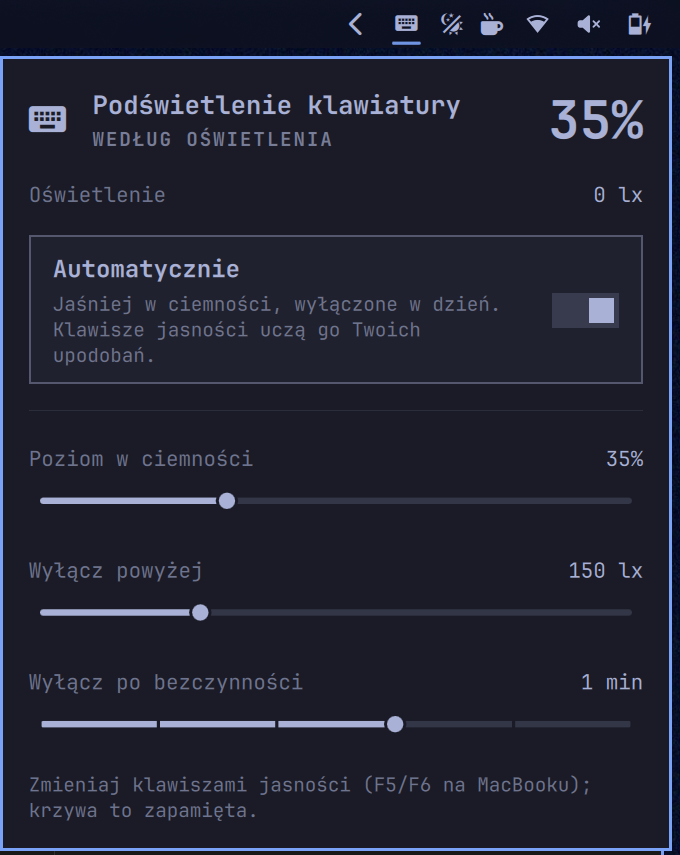

# Ambient Keyboard for Omarchy

**The Mac keyboard backlight, on Omarchy.** Built for Intel MacBooks: install it and stop thinking about the keyboard light. It glows softly in the dark, switches off in daylight, learns from the brightness keys, and goes dark while you are not typing, just like macOS.

> **Beta.** Tested on a 2015 MacBook Pro (MacBookPro11,5) on Omarchy 4.5. Other Intel MacBooks, and laptops with a light sensor and a backlit keyboard, should work but are not verified yet. **[Tell me how it runs on yours](https://github.com/pdurlej/omarchy-ambient-keyboard/issues/new/choose)**, whether it works or not.



## It just works

- **Follows the room.** The ambient light sensor sets the level: soft in the dark, dimmer as the room brightens, off in daylight. Readings are smoothed, so a passing shadow does not flicker the keys.
- **Learns from the brightness keys.** Press F5 or F6 (the keyboard brightness keys on a MacBook) and the plugin takes it as your taste: the whole curve shifts to match, and it keeps following the light from there. Nothing snaps back.
- **Respects "off".** Switch the keys off, or turn them on in a bright room, and that level stays until the room's light clearly changes or you next unlock.
- **Goes dark when you step away.** After a minute without input the keys fade out, and they come back the moment you touch the keyboard or trackpad.
- **Stays out of Omarchy's way.** While the lid is closed, the session is locked, or the displays are off, Omarchy's own handling is left alone; after unlocking, the keys fade straight to the right level.
- **No sensor? Still useful.** Without a light sensor the brightness keys set the level, and the keys still go dark while you are away.

## Easy to tune

Everything is optional. Open the panel from the keyboard icon on the bar:

| Setting | Default | Meaning |
| --- | --- | --- |
| Automatic | on | Follow the light sensor |
| Level in the dark | 35% | Backlight level in a dark room; the brightness keys adjust it too |
| Off above | 150 lx | Ambient light at which the keys switch off |
| Turn off after inactivity | 1 min | Never, 10 s, 30 s, 1 min, 2 min or 5 min |

The panel works from the keyboard: Up/Down (or `j`/`k`) pick a row, Left/Right (or `h`/`l`) change it, Enter toggles Automatic, Escape closes. Right-click the bar icon to turn the automation on or off.

Settings are stored in the plugin's entry in `~/.config/omarchy/shell.json`.

## Install

```sh
omarchy plugin add https://github.com/pdurlej/omarchy-ambient-keyboard.git --enable
```

It starts right away. The keyboard icon lands on the right of the bar; move or remove it like any other widget, and the automation keeps running either way.

If you previously ran your own backlight script, service, or plugin, stop it so the two do not fight over the keys.

### Update

```sh
omarchy plugin update pdurlej.ambient-keyboard --yes
omarchy restart shell
```

The restart matters: Omarchy reloads the plugin after an update, but the shell keeps running the previously loaded code until it restarts.

### Remove

```sh
omarchy plugin remove pdurlej.ambient-keyboard --yes
```

## Requirements

- Omarchy 4.5 or newer (Quattro shell plugin system)
- A keyboard backlight exposed as `/sys/class/leds/*kbd_backlight*`
- Optional: an ambient light sensor exposed through IIO (`in_illuminance_input`, or `in_illuminance_raw` with a scale)
- `brightnessctl` and `jq`, both shipped with Omarchy

To check what your machine exposes, run the plugin's read-only probe:

```sh
~/.config/omarchy/plugins/pdurlej.ambient-keyboard/probe
```

A non-empty `led` means the plugin can drive your keyboard; a number in `lux` means it can follow the light.

## Help test the beta

Every report helps, including "it just works":

- **[Hardware report](https://github.com/pdurlej/omarchy-ambient-keyboard/issues/new?template=hardware-report.yml)**: your laptop model, the probe output, and whether it worked.
- **[Bug report](https://github.com/pdurlej/omarchy-ambient-keyboard/issues/new?template=bug-report.yml)**: something misbehaves, such as the keys flickering, ignoring your changes, or not turning off.

Machines confirmed so far:

| Machine | Sensor | Backlight | Status |
| --- | --- | --- | --- |
| MacBook Pro 15" 2015 (MacBookPro11,5) | `acpi-als` | `smc::kbd_backlight` | ✅ works |

## Scripting

```sh
omarchy-shell pdurlej.ambient-keyboard status            # JSON: state, light, level, settings
omarchy-shell pdurlej.ambient-keyboard enable            # also: disable, toggle
omarchy-shell pdurlej.ambient-keyboard resume            # drop a held level and follow the light
omarchy-shell pdurlej.ambient-keyboard setDarkPercent 40
omarchy-shell pdurlej.ambient-keyboard setOffLux 200
omarchy-shell pdurlej.ambient-keyboard setIdleOffSeconds 30   # 0 = never
omarchy-shell pdurlej.ambient-keyboard.panel toggle      # also: open, close
```

## How it works

Every two seconds the service runs `probe`, a small read-only Bash helper that prints the backlight level, the light sensor reading, and whether the desktop is in use (lid, lock, displays) as one JSON line. The service smooths the reading and moves the keys toward the target by at most 5% of the range per tick.

A change it did not make itself is a manual one. When the curve can express it, the plugin scales **Level in the dark** so the curve passes through your new level at the current light, and saves that. When it cannot (the keys switched off, or turned on in a bright room), it holds your level until the light is half or double what it was.

Inactivity comes from the compositor's idle notification, so any keyboard, trackpad, or mouse input counts. Fades take about a quarter of a second.

## Security and system changes

- No network access, no privilege escalation, no packages, no system services.
- `probe` only reads `/sys` and `/proc` and runs `hyprctl -j monitors`.
- Brightness changes go through `brightnessctl`, which uses systemd-logind, so no extra permissions are needed.
- Settings writes touch only the plugin's entry in `~/.config/omarchy/shell.json`.

## Development

```sh
node tests/model.test.js
omarchy plugin validate .
```

The behaviour lives in `Model.js` as plain functions, so it is tested without a running shell. See `AGENTS.md` for notes aimed at coding agents.

## Credits

The keyboard-driven panel and the no-sensor mode were inspired by [floscom/omarchy-kbd-backlight](https://github.com/floscom/omarchy-kbd-backlight).

## License

MIT
